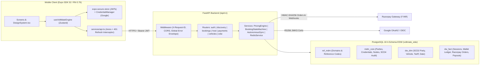
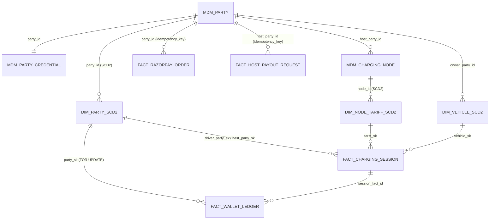
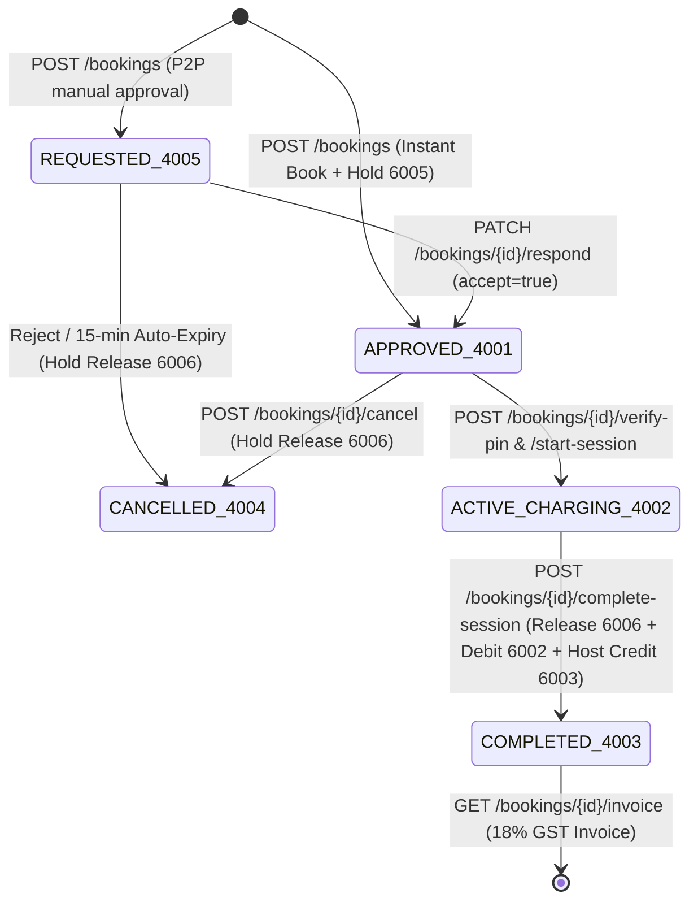
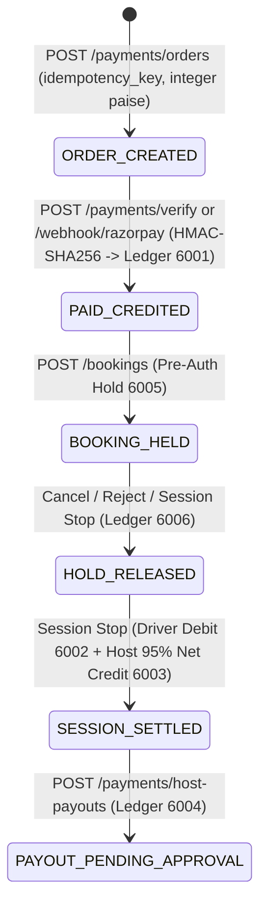

# VoltMate — Production EV Charging & P2P Home-Host Platform (`₹ INR`, India/Kerala)

VoltMate is an end-to-end EV charging discovery, slot reservation, 6-digit society gate-pass check-in, live charging telemetry, Razorpay wallet/payments, GST tax invoicing (`HSN/SAC 998714`), and Peer-to-Peer (P2P) home-charger hosting platform built for India/Kerala (`₹ INR`).

---

## 1. One-Command Local Setup & Verification

```bash
# 1. Start PostgreSQL 18 + PostGIS, Redis 7, Mosquitto MQTT & FastAPI Backend
docker compose up -d

# 2. Run the full 4-gate pre-commit & CI verification suite (Backend + Mobile)
bash scripts/pre-commit.sh

# 3. Start the Mobile App (Expo SDK 52 / React Native 0.76)
cd mobile && npm install && npx expo start
```

---

## 2. System Architecture Diagram



---

## 3. Database Schema / 4-Schema PostgreSQL EDW ERD



---

## 4. State Machine Diagrams

### 4.1 Booking & Charging Session Lifecycle (`dw_fact.fact_charging_session`)



### 4.2 Razorpay Payment, Wallet Hold & Host Payout Lifecycle



---

## 5. Repository Structure

```text
VoltMate/
├── AGENTS.md                       # Non-Negotiable Engineering Rules (1–11) for AI & Contributors
├── docker-compose.yml              # PostgreSQL+PostGIS, Redis 7, Mosquitto MQTT, FastAPI
├── scripts/
│   └── pre-commit.sh               # 4-gate verification script (stray env, py_compile, unittest, tsc + node --test)
├── .github/workflows/
│   └── ci.yml                      # GitHub Actions CI pipeline running all 4 verification gates
├── docs/
│   └── audit/                      # Feature completeness, duplication, dead-code, and risk audit reports
├── backend/
│   ├── .env.example                # Documented server-side environment variable names (no secrets)
│   ├── requirements.txt
│   ├── app/
│   │   ├── main.py                 # FastAPI lifespan, startup config validation, /health & /ready, CORS
│   │   ├── core/                   # config.py (centralized Settings), security.py, middleware.py, smtp_mailer.py
│   │   ├── db/                     # session.py, edw_schema.sql, init_edw.py, verify_edw.py
│   │   ├── models/                 # user.py, vehicle.py, node.py, booking.py
│   │   ├── schemas/                # common.py ({ code, message, details, requestId }), auth.py, booking.py, node.py
│   │   ├── services/               # pricing_engine.py, booking_state_machine.py, autonomous_sync_engine.py, osrm_router.py, redis_service.py, ocpp_mqtt.py
│   │   └── api/v1/                 # auth.py, discovery.py, bookings.py, host.py, payments.py, vehicles.py, edw.py, ws.py
│   └── tests/
│       └── test_core_engines.py    # 30 unit, characterization, security (IDOR/lockout), and E2E journey tests
└── mobile/
    ├── .env.example                # Documented EXPO_PUBLIC_* client variable names
    ├── package.json
    ├── scripts/
    │   └── test-characterization.mjs # Mobile characterization & architecture invariant test suite
    ├── android/                    # Native Android project + GoogleAccountPickerModule.kt (AndroidX CredentialManager)
    └── src/
        ├── theme/tokens.ts         # Single source of truth: 8pt spacing, typography, colours, tariffs & pure calculators
        ├── components/
        │   ├── ui/                 # DesignSystem.tsx, EvVisuals.tsx, ActiveChargingModal.tsx, RazorpayCheckoutModal.tsx, ToastBanner.tsx
        │   ├── map/                # LeafletMap.tsx
        │   └── navigation/         # FloatingBottomTabBar.tsx
        ├── services/               # api.ts (centralized EXPO_PUBLIC_* config & 401 refresh), googleAuthService.ts, razorpayService.ts, realTimeEvHunter.ts, hybridMapService.ts, localAuthRegistry.ts, notificationService.ts, indianEvCatalog.ts
        ├── store/                  # useVoltMateEngine.ts, engineTypesAndSeeds.ts, useAuthStore.ts
        └── app/                    # Expo Router screens: (auth)/, (driver)/, (host)/, _layout.tsx (with RootErrorBoundary)
```

---

## 6. Environment Configuration Reference

Copy [backend/.env.example](file:///home/nidhin/Documents/PROJECTS/My_Applications/VoltMate/backend/.env.example) to `backend/.env` and [mobile/.env.example](file:///home/nidhin/Documents/PROJECTS/My_Applications/VoltMate/mobile/.env.example) to `mobile/.env`. Never commit `.env` files or place server secrets in `EXPO_PUBLIC_*` variables.

- **Required in Production (`APP_ENV=production`)**:
  - `SECRET_KEY` (32+ char high-entropy JWT signing secret; validated at startup by `settings.validate_production_config()`)
  - `DATABASE_URL` or `POSTGRES_PASSWORD` (PostgreSQL 18 + PostGIS connection)
  - `GOOGLE_CLIENT_ID` & `GOOGLE_ANDROID_CLIENT_ID` (OAuth 2.0 client IDs for `id_token` verification)
  - `RAZORPAY_KEY_ID`, `RAZORPAY_KEY_SECRET`, `RAZORPAY_WEBHOOK_SECRET` (Razorpay order signing & webhook HMAC verification)

---

## 7. Deployment & Rollback Runbook

### 7.1 Backend Deployment & Health Verification
1. Validate environment & run pre-deploy checks:
   ```bash
   bash scripts/pre-commit.sh
   ```
2. Deploy container / systemd service:
   ```bash
   docker compose build backend && docker compose up -d backend
   ```
3. Verify liveness & readiness probes:
   ```bash
   curl -fsS https://api.voltmate.co.in/health
   curl -fsS https://api.voltmate.co.in/ready
   ```

### 7.2 Android Release APK Build
```bash
cd mobile/android && ./gradlew assembleRelease
cp app/build/outputs/apk/release/app-release.apk ../../VoltMate.apk
```

### 7.3 Rollback Procedure
- **Application Rollback**: Redeploy the previous tagged container image (`docker compose up -d --no-deps backend`) or distribute the previous signed `VoltMate.apk`.
- **Database Rollback Safety**: All wallet and session mutations (`dw_fact.fact_wallet_ledger`, `dw_fact.fact_charging_session`) and dimension versions (`dw_dim.dim_node_tariff_scd2`, `dw_dim.dim_party_scd2`) are append-only/SCD2-versioned (`CREATE TABLE IF NOT EXISTS` / `ON CONFLICT DO NOTHING`), ensuring backward-compatible schema state across rollbacks.
